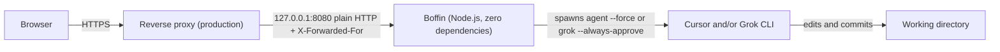

# Boffin

A mobile-friendly chat web UI for the Cursor Agent CLI (`agent`) and/or the Grok CLI (`grok`), bound to a fixed working directory. You chat with the chosen agent from your browser; it reads, edits, and commits files in its working directory on the machine Boffin runs on.

> **Know what you are running.** Boffin spawns the CLI with auto-approve on by default (`agent --force` or `grok --always-approve`; see `src/backends.js`) as the user running the server. The agent can run commands and edit any file that user can touch — including, if the working directory is this repository, Boffin's own source. Run it as a dedicated unprivileged user (production does; see below), on a machine (or directory) you are comfortable letting an agent modify. See [Security model](#security-model).

## How it works



- The server (`src/index.js`, `src/server.js`) serves the web UI, authenticates users with passkeys, and streams agent replies to the browser.
- Each chat message runs the chosen CLI in the configured working directory with the chosen model (`src/backends.js`, `src/conversation.js`). Conversation state is persisted to a JSON state file in the working directory. When more than one CLI is enabled, the owner picks Cursor or Grok (and a model) when starting a new chat. Cursor and Grok offer first-party models. When Grok is enabled, the header shows that account's quota as a thin bar. The percentage text appears only while the pointer is over the bar. The figure comes from Grok Build's local log (the snapshot it stores when it fetches billing). Current Cursor plans share that pool with Grok, so the same bar is shown even while the active chat is Cursor. Cursor legacy plans do not share it; their usage is a separate Cursor quota and is not shown. Anyone in the conversation can use **Refresh** in Settings to ask Grok Build to fetch billing again over ACP (`_x.ai/billing` on `grok agent stdio`) and then reread that log. A Cursor-only deployment has no usage display, because Cursor does not write that log. That ACP method is what the official TUI uses for `/usage`; it is not in Grok's public ACP sample, so xAI's terms do not name it. Calling it is still talking to the installed `grok` binary, not scraping grok.com. xAI could change or restrict the method, and the Grok account's terms still apply. Refresh does not drive the TUI: systemd has no terminal, and keystroke automation would only poke the same fetch, more brittle than the RPC.
- In production, Boffin binds to loopback only and a reverse proxy (Caddy) is the sole public entry point: it terminates TLS, which passkeys require, sets HSTS, compresses responses, and overwrites `X-Forwarded-For` so per-client rate limiting works behind the proxy (see `src/attempt-limit.js`). Boffin itself sends raw bytes and a strong ETag of those bytes so the proxy can compress without breaking 304s.

## Requirements

- **Node.js ≥ 20** (see `engines` in `package.json`). Boffin has no npm dependencies, so there is nothing to install.
- **Cursor Agent CLI** and/or **Grok CLI** installed and authenticated for the user that will run Boffin. Download each installer over HTTPS (TLS 1.2+, no protocol downgrade) to a private temporary file, read it, and run it only if you answer yes. The file is removed if the download fails, you abort, or the installer finishes:
  ```bash
  # Cursor Agent CLI (installs ~/.local/bin/agent)
  (
    set -euo pipefail
    tmp=$(mktemp)
    trap 'rm -f "$tmp"' EXIT
    curl --proto '=https' --proto-redir '=https' --tlsv1.2 -fsSL -o "$tmp" https://cursor.com/install
    if command -v less >/dev/null 2>&1; then less "$tmp"; else cat "$tmp"; fi
    printf 'Run this installer? [y/N] '
    read -r reply
    case "$reply" in y|Y) bash -- "$tmp" ;; *) echo 'Aborted. Installer not run.' >&2; exit 1 ;; esac
    rm -f "$tmp"
    agent login                # or configure an API key per Cursor's docs
    agent status               # verify you are signed in
  )

  # Grok CLI (installs grok; also drops an `agent` symlink — keep Cursor's ~/.local/bin/agent)
  (
    set -euo pipefail
    tmp=$(mktemp)
    trap 'rm -f "$tmp"' EXIT
    curl --proto '=https' --proto-redir '=https' --tlsv1.2 -fsSL -o "$tmp" https://x.ai/cli/install.sh
    if command -v less >/dev/null 2>&1; then less "$tmp"; else cat "$tmp"; fi
    printf 'Run this installer? [y/N] '
    read -r reply
    case "$reply" in y|Y) bash -- "$tmp" ;; *) echo 'Aborted. Installer not run.' >&2; exit 1 ;; esac
    rm -f "$tmp"
    grok login --device-auth   # headless/remote; follow the printed URL
    grok --version
  )
  ```
- **Git**, if the agent should commit its work in the working directory (recommended).
- For production: a **Debian 13 (trixie)** server reached by a fully qualified hostname, with an account named after your GitHub username whose SSH public-key access and git identity are already configured, and which has `sudo` (details under [Deploying to production](#deploying-to-production)). Other hosts work for local use, but the deployment skill targets this environment.

## Quick start (local)

```bash
git clone <this-repository-url> vibe
cd vibe/boffin
cp config.example.json config.json
# Edit config.json: set at least username and password.
node src/index.js "$PWD"
```

Then open <http://localhost:8080> (or the `host`/`port` you configured), sign in with the configured username and password, and create your owner passkey. Passkeys work over `http://localhost`; any other hostname needs HTTPS.

Notes:

- The first argument is the **working directory** the agent operates in; omit it to use the current directory. `config.json` must live in that directory. The directory is created if missing.
- If `config.json` is missing, Boffin writes one with safe defaults (username `boffin`, a randomly generated password, mode `0600`) and logs that it did — read the password from the file to sign in.
- `npm start` is shorthand for `node src/index.js` with the current directory as the working directory.
- The configured username/password are only a bootstrap credential for first-time owner passkey enrollment. Once an owner passkey exists, the server retires the password ("The password is no longer used") and sign-in is passkey-only. You can then remove `"password"` from `config.json` (startup still requires a password if `state_file` has no owner passkey). Enroll promptly after first exposing the server, and keep the hostname stable afterwards: changing it orphans existing passkeys.

## Configuration

`config.json` in the working directory (see `config.example.json` and `src/config.js`). Unknown keys are rejected, as is a `workdir` key — the working directory is the config file's location.

| Key | Default | Meaning |
| --- | --- | --- |
| `host` | `0.0.0.0` | Interface to bind. Use `127.0.0.1` behind a reverse proxy. |
| `port` | `8080` | Port to listen on. |
| `agents` | `["cursor"]` | Enabled CLIs: `"cursor"`, `"grok"`, or both. |
| `model` | *(required; example uses `composer-2.5`)* | Default first-party Cursor model (`composer-2.5`). |
| `grok_model` | `grok-4.7/high` | Default first-party Grok model (Grok 4.7 High). |
| `agent_bin` | `agent` | Path to the Cursor Agent CLI. Use an absolute path under systemd or other minimal environments. In production this is `/home/boffin/.local/bin/agent`. |
| `grok_bin` | `grok` | Path to the Grok CLI. In production this is `/home/boffin/.grok/bin/grok`. Do not put `~/.grok/bin` on `PATH`: that directory also contains `agent`, which would shadow Cursor's CLI. |
| `bun_bin` | `bun` | Bun executable used when the owner switches static assets to **release** (bundled) mode. |
| `force` | `true` | Auto-approve: `--force` for Cursor, `--always-approve` for Grok. |
| `username` | *(required\*)* | Bootstrap username for first passkey enrollment. Must not contain a colon. |
| `password` | *(required until enrolled\*)* | Bootstrap password, at least 8 characters. May be removed from `config.json` once an owner passkey is saved in `state_file`. Keep `config.json` at mode `0600`. |
| `state_file` | `data/state.json` | Conversation/passkey state, resolved relative to the working directory. |

\* `username`/`password` can instead come from the `BOFFIN_USERNAME` / `BOFFIN_PASSWORD` environment variables, which override the file. `config.json` and `data/` are git-ignored and must never be committed.

By default the web UI loads separate JavaScript modules (handy while editing). The owner can switch to **release** in Settings to bundle those files with Bun for faster first loads on slow links; everyone shares that mode. Install Bun with `scripts/install-bun.sh` (uses `unzip` or, if missing, `python3` to extract the release zip). See the deploy skill. Generated output lives in `public/dist/` (not committed).

## Deploying to production

The deployment assumes an environment that is **already configured** — the skill does not set any of this up:

- You have a Debian 13 (trixie) server known by a fully qualified **hostname**, used for both SSH and the Boffin service (`https://<hostname>`). Passkeys bind to that hostname, so it must be final.
- Your account on the server has the **same name as your GitHub username**, SSH **public-key login to `<github-username>@<hostname>` already works**, a **git identity is already configured** (locally and for that account on the server), and the account has **`sudo`**. Your GitHub username is used **only for SSH** — logging in to administer the server, and git-over-SSH pushes when deploying or upgrading the Boffin source. It is not the account the service runs as.
- The **firewall is already configured** (on the host and/or at the provider) to permit SSH, 80, and 443. The deployment does not install, enable, or modify any firewall rules.

The production topology is: **Caddy** (public 80/443, automatic Let's Encrypt TLS) → **Boffin** as a systemd service running as a dedicated **`boffin` user**, bound to `127.0.0.1:8080`, with the deployed repository at `/srv/boffin` (owned by `boffin`) and Boffin's project subdirectory `/srv/boffin/boffin` as both the service's working directory and the agent's working directory. The chosen CLI(s) are installed and authenticated as `boffin` (credentials in `/home/boffin`); the deployment skill copies your pre-configured git identity to that account so the agent's commits carry it. The pre-configured firewall is left exactly as it is — the deployment adds no rules, and port 8080 needs none because Boffin is loopback-only behind Caddy. You never SSH in as `boffin` — administration is over your own account plus `sudo -u boffin`.

Code updates are pushed over SSH as your own account into that checked-out repository (`receive.denyCurrentBranch=updateInstead`). Your local `deploy` remote configures `uploadpack` and `receivepack` to run `git-upload-pack` / `git-receive-pack` as `boffin` via a narrow `/etc/sudoers.d/boffin` rule (`sudo -n -H -u boffin`). That keeps `/srv/boffin` owned exclusively by `boffin:boffin` with no shared group or `chmod` step, and ensures Git never executes `boffin`-writable `.git/hooks` or `.git/config` under your operator account. The skill spells out the exact setup and per-update steps.

Full step-by-step deployment — precondition checks, service and proxy setup, verification, updating, rollback, and troubleshooting — is provided as an **agent skill**:

- **[`.agents/skills/deploy-boffin/SKILL.md`](.agents/skills/deploy-boffin/SKILL.md)** — a generic [Agent Skill](https://agentskills.io) (not tied to any one vendor's agent). Point any skills-capable coding agent at it and tell it three things — **your GitHub username (for SSH only), your deployment server hostname, and which agent(s) to install (Cursor, Grok, or both)** — and it will deploy Boffin to your server. It does not ask for a model: Cursor uses Composer 2.5 and Grok uses Grok 4.7 High. Human operators can also follow it as a checklist: every step is a plain shell procedure with its own verification.

Day-to-day operations after deployment (over `ssh <github-username>@<hostname>`):

```bash
sudo systemctl restart boffin   # apply code/config changes (the agent cannot do this itself)
journalctl -u boffin -f         # follow service logs
sudo systemctl reload caddy     # after editing /etc/caddy/Caddyfile
```

- **Update:** if `<github-username>` is still a member of group `boffin`, `/srv/boffin` is mode `2775`, or the `deploy` remote has no `uploadpack` / `receivepack`, run the skill's one-time migration first (sudoers, remote helpers, ownership). Then `git pull --rebase deploy main` (pick up any commits the agent made), `git push deploy HEAD:main`, and restart the service (`sudo systemctl restart boffin`). A push is refused if the server working tree has uncommitted changes — settle the agent's edits as `boffin` first (details in the skill); the service does not need to be stopped for an update. Never copy files over `/srv/boffin` with `rsync`/`scp`; it would overwrite the agent's work and its `.git`.
- **Recover from a bad agent edit:** over SSH, inspect `sudo -u boffin git -C /srv/boffin log`, `git reset --hard <good-commit>` (or `git revert`) as `boffin`, then restart the service. Uncommitted breakage: `sudo -u boffin git -C /srv/boffin checkout -- .`.

## Security model

- **Agent blast radius.** With `force: true`, the agent executes with the full privileges of the `boffin` service user: it can read `config.json`, the state file (passkeys and conversation), and the CLI credentials in `/home/boffin`, and run arbitrary commands as `boffin`. The dedicated user protects the rest of the system — your own account (and its SSH keys and `sudo`) and root — not the app. Only give Boffin a working directory you accept an agent may modify destructively; git history in that directory is your recovery path.
- **Authentication.** The bootstrap password only enrolls the first owner passkey and is then retired. Additional members join via owner-issued invite links and their own passkeys. Password attempts are limited to 8 and passkey attempts to 30 per client address per 15 minutes (in-memory; a restart clears the counters).
- **`X-Forwarded-For` trust.** Rate limiting keys on the real client address. Boffin trusts `X-Forwarded-For` only from loopback peers and only takes the last entry, and the production Caddy config overwrites the header with the real peer — so this is safe only while Boffin stays loopback-only behind that proxy. If you change `host` or the proxy topology, re-read `src/attempt-limit.js` first. (Any local process, including the agent, can connect over loopback and choose its own header value; it can already read the credentials in `config.json`, so this adds no exposure.)
- **SSH and git identity are yours, pre-configured.** The deployment procedure never installs keys, edits `sshd_config`, or invents a git identity; it verifies that `ssh <github-username>@<hostname>` works and that an identity exists, copies that identity to the `boffin` account for the agent's commits, and stops if either is missing. No SSH key is added for `boffin` — your account (via `sudo`) is the only administrative path in.

## Development

```bash
node --test   # run the test suite (Node's built-in runner; no dependencies to install)
```

Layout: `src/` is the server, `public/` the web UI, `shared/` code shared by both, and `test/` the tests. `fixtures/fake-agent.js` stands in for the real `agent` CLI in tests.
